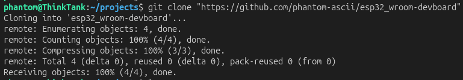

# Oct 28 Cant wait to make my first devboard
Basiclly im making an esp 32 wroom devboard. Why? well.... idk icl i just need to upgrade my ecad skills ig, anyways enjoy the ride

**Total time spent: 0 minutes**
